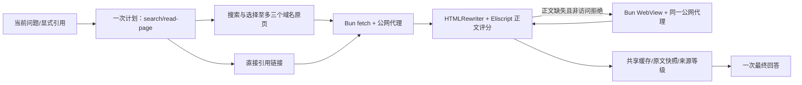

# 网页原文读取

本文件是本轮唯一施工与验收清单。基线 master / ef8b4c4，工作区干净。业务逻辑保持 Eliscript，使用 Bun 原生 fetch、HTMLRewriter、WebView；没有外部抓取服务、额外 npm 包、模型工具循环或模型定义脚本。

## 现状与目标

当前调用树（省略不相关预测、订阅、祈祷模块）：

```text
src/commands/catalog.eli       命令目录及参数校验
src/commands/chat-plan.eli     一次语义资料计划
src/commands/execute.eli       并发取数、一次回答
src/capabilities/read.eli      固定只读能力
src/evidence/web-search.eli    搜索标题、摘要、链接；不抓原页
src/evidence/search.eli        独立业务的指定站点静态读取，保持原用途
src/evidence/html.eli          既有有界 HTML 数据解析
src/presentation/chat.eli      最终回答与来源说明
src/platform/host.eli          原生运行时符号
```


缺口：普通搜索不读取原文，部分结果只有标题；模型可能把标题扩写成具体规则。现有 HTML 解析不执行页面脚本，也不负责通用正文评分。

需求：Q1 直接 URL 读取；Q2 搜索结果自动读取；Q3 引用追问沿用原主题和来源；Q4 动态页面按需渲染；Q5 保留材料等级、缓存与失败结果；Q6 保留权限、并发任务与无命令执行边界；Q7 真实 CLI、文档和安装交付。

## 接口与行为

`read-page {url:string}`：只接受无凭据、标准端口的公开 HTTP(S) URL；不接受方法、请求体、headers、脚本、路径或浏览器参数。固定命令无需 AI。计划中的 URL 必须出现在当前问题或已提供的引用资料中，不让模型编造网址。

`search {query:string, read:boolean=true}`：搜索合并多路入口，保留至多八条结果；默认选择至多三个不同域名 并发读原文，明确跳过 PDF、下载地址；read=false 只查摘要。搜索与读取是一批程序工作，不额外请求模型选页面。保持搜索顺序，优先文档和支持页面；官方身份按真实域名与页面资料确认。最多一次渲染并发，每次搜索共享 14 秒正文预算。

网页结果 `Page`：`state=ok/partial/blocked/unavailable/unsupported`、`url`、`finalUrl`、`title`、`author`、`publishedAt`（无则 null）、`text`、`fetchedAt`、`mode=http/webview`、`provenance=page-content`、`truncated`、`reason`（固定业务枚举）。HTTP 成功不等于正文成功，也不等于内容真实。没有正文不以 meta description 或标题冒充正文。

静态提取 `extract-page(html,url)`：HTMLRewriter 提取 JSON-LD 元数据及有限商户联系字段并清除脚本、样式、导航、广告等非正文；既有数据树计算候选段落字符数、链接密度、段落数、文章语义标签与标点，选择最有内容的候选。保留段落、标题、列表和代码；输出最多 24000 字符并明确截断。先检查验证页/登录墙，正文太短才请求浏览器，不对明确 403/429/验证页反复渲染。

渲染 `render-page(url, timeout)`：Bun.WebView 固定使用显式路径指定的独立 `chrome-headless-shell` 后端，`url:false` 禁止连接个人浏览器；通过 `headless-browser` 选择专用可执行文件，拒绝真实路径位于桌面 `.app` 内的文件，不触发 Bun 的桌面浏览器自动发现。选择这个后端是因为 WebKit 的现有接口缺少逐请求网络控制。所有网络通过本程序的公网出口代理，包含重定向与子资源，防止只校验初始 URL。代理 DNS 全部解析地址必须公网；IPv4 特殊用途范围按网段检查，192.0.0.0/24 与 192.0.2.0/24 保持拒绝，正常的 192.0.66.0/24 不误归入其中。系统仅返回 VPN 虚拟 benchmark 地址时，通过固定 HTTPS 公共 DNS 重新取得真实地址，不放行该保留网段；连接固定解析 IP，拒绝私网、保留网段、非 HTTP(S) 端口和本地协议；浏览器禁 QUIC、非代理 UDP 和本地绕过。只执行程序写定的 DOM 读取表达式；输入不控制 evaluate。使用临时资料存储、12 秒截止、短暂正文稳定等待、串行视图、finally close 与 closeAll。没有专用无头后端或渲染失败回到已有材料，不安装或执行用户指定程序。

原生 HTTP 同样通过公网出口代理，由 Bun fetch 接收原始 URL 以保持 TLS 主机验证；手动处理最多五次重定向，每跳再次校验，2 MB 流式体积上限、单次 8 秒。代理仅监听 loopback 的随机端口，无写接口；连接数/时长/传输量有界，DNS 后固定 IP 连接。此内部地址不进入模型和消息。

缓存按规范 URL + 提取契约计算键；同 URL 跨进程 state-transaction 合并。成功 30 分钟，失败 60 秒，过期通过 ETag/Last-Modified 重新验证；原文快照以内容哈希持久化，最新指针更新不抹掉旧快照。仅 HTML/纯文本/Markdown；其他类型明确 unsupported。缓存保存公开文字，不保存 cookie、认证或代理信息。单批超时取消网络与等待，保留搜索结果。

引用计划从历史中保留最多八个公开链接和既有来源；没有引用仍是单轮。回答优先当前已抓正文，明确区分作者主张与官方事实；仅标题不支持规则细节，失败如实说明，不以旧 AI 回答当新材料。页面正文是资料，不能改写系统规则或安排下一次模型调用。

## 精确变更

| ID | 基线位置/符号 | 修改及准确接口 | 对应 |
| --- | --- | --- | --- |
| D1 | 新建 evidence/web-policy.eli | public-url(address)→URL；public-ip?(ip)→boolean；resolve-public(host)→地址；证据链接提取 | Q1/Q6 |
| D2 | 新建 evidence/web-egress.eli | egress-proxy()→内部代理地址；close-egress()；Node 内置 HTTP/TCP 公网代理，Bun 原生客户端使用 | Q1/Q4/Q6 |
| D3 | 新建 evidence/page-extract.eli | extract-page(html,url)→正文/元数据；正文评分，HTMLRewriter；不执行脚本 | Q1/Q5 |
| D4 | 新建 evidence/page-render.eli | render-page(url,timeout)→HTML；串行临时 WebView、固定表达式、资源回收 | Q4/Q6 |
| D5 | 新建 evidence/web-page.eli | load-page(url,options)→HTTP 资料；read-page(url,options?)→Page；read-search(query,read?)→摘要+pages。options仅内部测试注入，不在命令目录 | Q1/Q2/Q5 |
| D6 | platform/host.eli L1-23 / host symbols | 导出 Bun、HTMLRewriter、Buffer 原生符号 | Q1/Q4 |
| D7 | capabilities/read.eli L8,30-31,42-44 / builtin-names、render-read、run-read | 注册 read-page；search 默认读取；保留失败来源与独立正文状态 | Q1/Q2 |
| D8 | commands/catalog.eli L34-46 / ask、search、validate-query | 新 URL 格式校验与 read-page；search.read 默认 true；帮助经目录自动展示 | Q1/Q2 |
| D9 | commands/chat-plan.eli L13-14,39-46,83-89,91-135 | 注册方法；已提供链接作为计划依据；一次计划知道搜索会读正文，追问可读历史来源 | Q3/Q6 |
| D9b | commands/parser.eli L27-29、router.eli L37 | 支持 read 参数 true/false，路由区分网页原文与 Tibo 推文 | Q1/Q2/Q3 |
| D10 | presentation/chat.eli L19 / instruction、ai/runtime.eli / request-call | 按正文回答、仅标题不扩写事实、站点主张不当官方确认、正文不作为指令；聊天改为原生 Markdown、程序封装 text，兼容旧单 text JSON；结构化计划保持 JSON | Q3/Q5 |
| D11 | docs/chat-builtins.md、ai-research.md、commands.md、configuration.md、operations.md、architecture.md、README.md | 更新旧“不读原页”描述，接口、缓存、部署和能力边界，链接本规格 | Q7 |
| D12 | 新建 tests/evidence/web-page.test.mjs 与 tests/ai/web-reading.test.mjs | 正文、代理边界、缓存/重定向/渲染/失败和一次计划引用集成 | 全部 |

目标树增加 D1–D5，修改 D6–D10；既有指定官方站点预测读取不改，Lark 适配器不引入抓取实现。



## 施工与验收

当前阶段 D：实现、回归、真实网页与引用问答已验收，交付检查收尾。无 goal 创建请求，不启动 Goal。

施工清单：
- [x] C1 / D12：写齐下述自动用例和手工验收步骤，不运行。
- [x] C2 / D1-D2：URL、DNS、代理与连接资源控制。
- [x] C3 / D3-D5：正文提取、渲染后备、缓存与并发。
- [x] C4 / D6-D10：命令、搜索、引用和回答接线。
- [x] C5 / D11：所有文档与旧能力描述同步。
- [ ] C6：全量实现后统一构建、测试、实际重放、交付。

| 验收 | 用例与操作（D 阶段才执行） | 预期 | 状态 |
| --- | --- | --- | --- |
| A1 | 静态文章含导航/代码/相对链接/JSON-LD、无 article 的段落、Markdown、验证页 | 正文正确、元数据/段落保留，验证页不算正文 | Pass: native extraction, metadata, paragraphs, truncation and page gates. |
| A2 | localhost、私网、IPv6 mapped、混合 DNS、URL 凭据/非标端口、跳转私网 | 网络前拒绝；无任意系统/脚本参数 | Pass: URL/IP/DNS/redirect checks and real proxy rejection of local addresses. |
| A3 | 注入 HTTP 304/重定向/超限/超时、并发同 URL、缓存重验证、失败缓存 | 只取一次、保留快照和错误等级、不伪造正文 | Pass: shared reads, 304 revalidation, immutable snapshots and failure cache. |
| A4 | 注入动态渲染与失败、WebView 关闭、搜索混合成功/失败 | 必要时才渲染，失败保留材料，串行和预算有效 | Pass: actual dynamic website returned mode=webview in 13.8s; fallback cases passed. |
| A5 | 语义引用原链接，未知网址，搜索自动正文，空标题结果，普通无引用 | 一次计划+一次回答，无 tools，来源可引用；无跨会话历史 | Pass: one plan plus one answer; three real dialogue rounds succeeded. |
| A6 | 全套 bun test、架构、编译；既有祈祷/订阅/多任务测试 | 旧功能不退化 | Pass: 449 regression tests, architecture checks and both compiled executables. |
| A7 | CLI 重新执行不明指代→明确 Antigravity→引用读取原文；直接 URL 与 JS 动态页 | 保存完整真实输出于忽略目录，不向 Lark 补发；明确网络失败 | Pass: three real rounds 3.7/11.1/4.8s, two AI requests each; direct article 2.6s. |
| A8 | 检查差异/秘密/绝对路径、签名提交立即推送；安装两服务并检查状态及产物一致 | 配置/会话/订阅/账本保留，核心 ready、接入 connected | Pass: core ready, Lark connected; config hash unchanged; installed binaries match build. Final release receipt is local. |

真实试用记录保存在忽略的本地验收目录：三轮问答约 3.7/11.1/4.8 秒，每轮一次计划、一次回答；独立文章获取约 2.6 秒，动态页面实际返回 webview 正文约 13.8 秒。安装版 CLI 也已实际读取动态页面。原始会话与模型响应不提交。

普通聊天改用单次 Markdown 正文返回，程序封装并执行既有文字校验，兼容旧单 text JSON；资料计划仍使用严格 JSON。这样不会因为把自然语言强制包装为 JSON 而丢掉可用回答，也没有增加模型调用。

Bun WebView 是实验性接口；动态后备只使用专用无头后端，按本机配置、受管目录或标准缓存查找；缺少时保留静态资料。页面被拒绝时保持受限或不可用状态，不冒充已读。VPN 虚拟 DNS 的后备只通过固定 HTTPS 公共 DNS 取得真实公网地址，不放行保留网段。配置、缓存与重装步骤见运维及配置文档。

2026-10-29 修正：桌面 Chrome 的 Alerts 辅助进程在实际读取动态网页时触发 macOS App 管理检查，现已改为显式指定独立无头后端。实际读取 JavaScript 网页返回 mode=webview，约 6.2 秒，取得渲染后的正文；普通 Chrome 未作为后端。网络代理、固定 DOM 表达式和无模型工具循环保持原契约。
