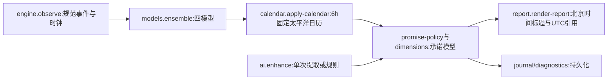
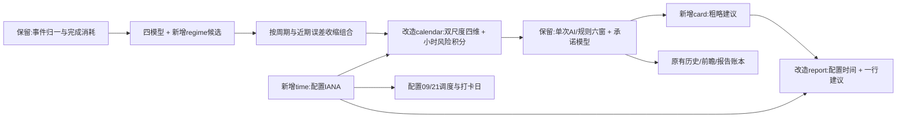

# 动态时间层与重置卡建议施工契约

基线：master / e7b581d，工作区干净。当前阶段 D：运行验收已完成，准备签名提交推送；本次不建立自动 Goal。

## 需求与边界

Q01 保留四种基础模型和六个发言时间窗、官方资料窗、单次 AI、承诺兑现与完成消耗；历史时间层在 AI 失败时始终运行。
Q02 新增随数据更新的近期节奏，避免把本次研究的比例或时间段写成结论常量；小样本向长期/均衡收缩。
Q03 增加日内分布，保留星期、月内日期、月阶段；按暴露量而非简单占比统计，避免高维稀疏交互和重复放大。
Q04 UTC 存储，IANA 时区配置统计/显示/每日两个固定时点；源文 PST/PDT 仍按作者语义解释，个人不能修改订阅时间。
Q05 公开预测增加一行重置卡粗略建议，无账户读取、无自动用卡；默认讨论额度不足且有即时使用需求。
Q06 文档、真实 CLI、回归、签名提交推送、两个已安装服务重装，保留所有运行数据。

## 当前源码与流程

```text
src/platform/{util,config,service}.eli   UTC、旧北京时间助手、配置与安装
src/forecast/{history,models,calendar}.eli  间隔、四模型、固定太平洋日历
src/forecast/{forecast,dimensions}.eli  历史与明确交付模型
src/forecast/{experience,journal}.eli  前瞻经验、逐报告持久化
src/evidence/dimensions.eli            六窗与官方资料输入
src/ai/{dimensions,enhance}.eli        一次评分与失败降级
src/app/{engine,forecast-cache,diagnostics}.eli
src/presentation/{report,forecast-evidence}.eli
src/subscriptions/{schedule,registry}.eli
src/prayer/pray.eli                    北京时间打卡日
src/commands/{catalog,router}.eli      订阅说明
```



## 固定设计和数据契约

### 动态节奏

新增 `tibo.forecast.regime`：`regime-rate(samples,elapsed,now)` 返回 `{policy,rate,longRate,profiles,shrink}`，`regime-probability(rate,hours)` 返回百分比。samples 是已结束且非 observed 的间隔；未来结束样本排除，不拼接不可靠间隔。长期率使用原90天衰减；profiles 的半衰期为14/45/90天，均是可说明的时间尺度，不是硬编码预测。各尺度记录 mass、squaredMass、exposureDays、censoredDays、effectiveN、rate。`rate=(mass+4)/(exposure+censor+4/longRate)`；当前未结束等待按衰减积分计入暴露；按 `effectiveN/(effectiveN+8)` 收缩对数率比后取三个尺度平均。零样本回到长期先验。只作为第五候选，不再给四模型整体乘一次提速因子。

`models.candidates` 保留原四行及公式；新增 `all-candidates` 追加 adaptive-rate。`replay` 保留原 n/sum/Brier 诊断，同时逐周期平均损失，保存 cycles/cycleBrier/recentBrier（45天衰减）防止同周期多时点冒充多周期。`ensemble` 以周期而非 n 启用经验：至少8回放周期或30前瞻窗口；学习部分权重正比 `1/(0.05+error)`，长期/近期周期误差均值；学习份额 `n/(n+20)`，其余均衡权重。时钟未知停用条件候选，并不给新候选未知的等待时长。预测曲线与最终值共用一次候选权重。

### 时区与日历

新增 `tibo.platform.time`，`time-settings()` 每次解析环境，返回 `{displayZone,forecastZone,scheduleZone}`：TIBO_TIMEZONE 默认 UTC，TIBO_FORECAST_TIMEZONE / TIBO_SCHEDULE_TIMEZONE 默认继承；非法 IANA 值明确报本地配置错误。`local-vector(at,zone)` 使用缓存 Intl 格式器返回 epochMs/date/weekday/dayOfMonth/monthPhase/hour/minute/hourBucket；`local-time` 返回 MM-DD HH:mm，`zone-label` 显示时区（Asia/Shanghai 可显示北京时间）。统计区由配置决定，不随运行主机变化。显式作者语义时区不变。

calendar temporal-history(events,now) 保留 UTC/pacific 兼容字段，增加 local/settings。rate-tables 只使用 verified、非 observed 的完成，分别做45/180天衰减，各有 weekday(7)/dayOfMonth(31)/monthPhase(3)/hourBucket(8) 桶。暴露按 UTC 15分钟边界累计到配置时区，包含当前未结束等待，处理DST/半小时偏移。每桶向整体率做Gamma-Poisson平滑（weekday/hour先验14天，date/phase28天），再乘桶事件质量/(质量+3)、全局有效事件量/(量+20) 收缩对数率比。每维按暴露量归一化到平均1。短期分布向长期分布按有效事件量/(量+20)收缩。三个日期维度平均对数比作为一组，与小时维度平均，不累乘四份相关证据；总率比限制2/3..1.5。桶空时接近1而非0。

保留原9点6h基础曲线/调整曲线与8个segments兼容结构；每个6h基础累积风险分成6个1h增量，按未来时刻日历率比累计，另存48个hourSegments。日内分布改变风险位置，不直接给整个24h添加固定百分点。无事件返回中性日历。

### 重置卡建议

新增 `tibo.forecast.card`：`card-advice(prob)` 返回 `{policy,decision,text,p24,p48,assumption}`。若预测不可用为unknown；p24>=65倾向等待；p24>=35或p48>=60不急先等；否则有即时需求可考虑用卡。阈值是可审阅决策偏好，不冒充最优学习模型。没有个人额度/用量/卡到期数据，绝不猜测账户状态、建议购买或自动用卡。`apply-dimensions` 在所有概率路径结束后保存该对象，renderer 重算以避免旧对象过期。公开只加概率区一行“重置卡：…”，不增AI请求。

### 配置、缓存与运行

策略版本11；预测缓存版本12，配置身份包含三种时区（AI/无AI都包含）。日历输入保持六窗与官方背景完整。诊断和报告账本保存 cardAdvice，时间完整数据仍由 temporal 保存。

订阅只允许系统配置的09/21两个时间，schedule 按 scheduleZone 以UTC分钟扫描未来48h寻找下一时点，按真实UTC时刻去重，用户命令仍不能自定义时间/时区。默认UTC；已有安装升级配置缺值时写明旧实例的 Asia/Shanghai 以保持既有推送，管理员可改；算法不内置北京时间。上香打卡日沿 displayZone。catalog/router 去掉固定北京时间说明，registry 动态展示配置时区。业务原文时间助手 utc 保留，预测正文改用展示区。

## 逐文件差异（绑定基线行号与符号）

| ID | 文件与基线锚点 | 精确操作 | 验收 |
|---|---|---|---|
| D01 | platform/time.eli 新建；util.eli L15 beijing | 新增上述时间函数；删除未再使用的固定北京时间助手与导出 | A01 |
| D02 | forecast/regime.eli 新建；models.eli L4 model-names/L37 baseline-curve/L46 replay/L68 ensemble | 追加第五候选、周期评分、收缩权重、同权重曲线 | A02 |
| D03 | forecast/calendar.eli L9 calendar-vector/L15 temporal-history/L38 rate-tables/L67 apply-calendar | 上述双尺度四维日历与小时积分，保留兼容字段 | A03 |
| D04 | forecast/card.eli 新建；dimensions.eli L41 policyVersion/L67 result | 新建议与策略11，所有路径保存建议，保留承诺逻辑 | A04 |
| D05 | forecast/forecast.eli L34；app/engine.eli L62；forecast-cache.eli L18/L38 | 版本11、模型理由、配置参与缓存身份 | A02/A05 |
| D06 | presentation/report.eli L4/L9 render-report；forecast-evidence.eli report-reasons | 配置时间标题/引用、概率区新增一行建议；模板版本4 | A04/A05 |
| D07 | subscriptions/schedule.eli L4 slot-at/L9 next-slot；registry.eli L7/L75/L99 | 时区调度与动态说明；两个固定时点不变 | A06 |
| D08 | prayer/pray.eli L37 day-at；commands/catalog.eli L33；router.eli L37 | 配置打卡日，移除固定时区话术 | A06 |
| D09 | platform/service.eli 配置补齐分支；app/diagnostics.eli forecast；forecast/journal.eli 报告记录 | 安装配置显式保留旧时区，保存卡建议 | A05/A07 |
| D10 | docs/{dimensional-forecast,numeric-forecast,decision-contract,forecast-report,configuration,operations,README}.md；.env.example | 同步算法、模板、时区、升级与卡建议；旧设计矛盾指向当前规范 | A07 |
| D11 | tests/forecast/{adaptive-time,card}.test.mjs；tests/platform/time.test.mjs；helpers/setup.mjs与bunfig.toml显式固定旧测试时区；原 models/dimensions/report/subscription/policy、app/core、app/degradation、app/forecast-cache tests | 新增行为与失败测试、修改旧假定，不删原业务覆盖 | A01..A06 |

新增与目标树：
```text
src/platform/time.eli                 + 时区配置/Intl缓存
src/forecast/regime.eli                + 节奏候选
src/forecast/card.eli                  + 卡建议
src/forecast/{models,calendar}.eli     ~ 动态时间层
src/forecast/{forecast,dimensions,journal}.eli ~ 接线/版本/诊断
src/app/{engine,forecast-cache,diagnostics}.eli ~ 版本/配置身份
src/presentation/report.eli            ~ 配置时间与卡建议
src/subscriptions/{schedule,registry}.eli ~ 配置固定双时点
src/prayer/pray.eli                    ~ 打卡日
src/commands/{catalog,router}.eli       ~ 时区说明
src/platform/service.eli               ~ 升级设置
```



## 双清单与验收

施工：
- [x] C00 / S0 固定全部设计及基线，当前说明文档为唯一入口。
- [x] C01 / S1 写齐所有测试但不运行（D11）。
- [x] C02 时间配置和调度/打卡/说明接线（D01/D07/D08/D09）。
- [x] C03 第五候选与周期权重（D02/D05）。
- [x] C04 四维双尺度日历、小时积分（D03）。
- [x] C05 建议、报告、缓存、诊断与版本（D04/D05/D06/D09）。
- [x] C06 / S2 同步全部文档和配置例子（D10），全实现结束。
- [x] C07 / S3 集中测试、实际CLI与两个服务重装验收（A01..A07）；签名推送随本变更交付，结果以Git实际记录为准。

验收（D阶段前均待执行）：
- [x] A01 不同IANA/非法值/跨日/DST/独立统计区；改变展示区不改变预测。
- [x] A02 短间隔加速、长间隔放缓、右删失、无未来泄漏、第五候选收缩/权重和为1、按周期有效样本；原四模型公式保留。
- [x] A03 所有日历维度/小时暴露/DST/空桶/稀疏收缩/样本增长变化/未来48h单调，保留兼容8段与新增48小时段。
- [x] A04 卡建议三档和未知、无账户推测；固定报告只多一行、语义提取不影响时间层。
- [x] A05 原六窗/单次AI/失败等时间层/完成消耗/新承诺/冷热启动/缓存时区失效；复用原测试。
- [x] A06 配置区只有09/21、个人不能改订阅计划、DST次时点、祈祷日与多任务回归。
- [x] A07 `bun run test` 435项通过；真实CLI默认与--no-ai均18%/32%，AI状态ok/disabled；历史前后95%/96%→12%/25%；compile与两服务install成功，核心ready、Lark connected，安装二进制与构建哈希相同，安装CLI输出策略11和卡建议。签名推送为后续交付动作，不将未发生的Git操作冒充完成。

实际证据放在被忽略的 `.tibo/research/adaptive-time/`；不提交原始日志/配置/个人会话。只收集本次进程，不清空历史。验收失败统一成批修复再复验受影响项。后续维护只更新本清单。

D阶段首轮：编译修正calendar括号作用域后，434用例中431通过、3项旧断言需随第五候选/配置时区更新；新时间层/卡建议/降级测试通过。已成批更新断言，补上双缓存时区失效用例，等待复验。

最终运行证据：`.tibo/research/adaptive-time/`内tests-final.log、acceptance-summary.json、cli-ai/native.json、replay-before/after.json、installed-forecast.json及服务状态。源码默认UTC，升级实例显式保存显示Asia/Shanghai、统计America/Los_Angeles。daemon已ready但维护报告尚未到下一生成周期，保留旧daemon-latest是正常行为；新版本报告由安装CLI已实际核实，不冒充新定点推送验收。删除未调用的旧固定北京时间助手，避免后续误用。
