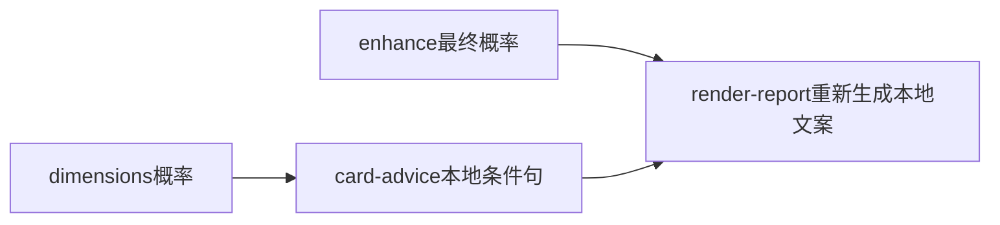

# 明确用卡倾向与可选AI文案

基线master/4cfe427，工作区干净。阶段D，运行验收与部署完成，准备签名交付；先固定设计，再写全测试但不运行，全部实现后集中验收。唯一施工入口为本文；不启动自动Goal。

## 需求

Q1 一行明确的用卡或等待倾向，加最关键的一句理由，不再给两边都成立的条件句。
Q2 AI可用时生成简短、自然、结合当前概率和公开证据的理由；关闭/失败/超时/冷却时使用多个概率档位的本地预置文案。
Q3 仍由程序计算概率并确定粗略行动方向，AI解释不改变概率；当前账户状态保持未知，不读取或使用卡。
Q4 共用网关缓存和失败冷却；不在renderer内请求，不随订阅人数重算；保持六窗一次请求与无AI降级。
Q5 文档、实际CLI、签名提交推送、核心与Lark重装；保留运行数据和上下文。

## 当前与目标源码/流程

```text
src/forecast/card.eli       旧三档条件文案
src/forecast/dimensions.eli 原生计算后存cardAdvice
src/ai/enhance.eli          最终语义概率计算
src/ai/runtime.eli          可选brief网关/缓存/冷却
src/presentation/report.eli 每次重算本地card并丢弃AI文案
src/app/forecast-cache.eli  共享预测缓存
```



目标新增 `src/ai/card.eli`，其余结构保留：


## 设计与逐文件施工

D01 `src/forecast/card.eli` L3 card-advice：策略card-advice-2，字段 `{policy,decision,tier,label,text,p24,p48,source,assumption}`。24h>=85为very-high/wait/建议先等，>=65为high/wait/倾向先等，>=35或48h>=60为medium/lean-wait/略倾向先等，>=15为low/use-now/倾向现在用，其余very-low/use-now/建议现在用。每档三条短理由，按概率和选择稳定变体，不随渲染随机跳变。未知为unknown。先写label再接一句理由；统一假设usable-card-and-choice-to-spend-or-wait。新增 `current-card(prob)`：仅当保存对象策略、概率、方向/档位与当前一致且文本合法时复用，否则重新生成本地建议。

D02 新增 `src/ai/card.eli`：`card-input(result,advice)` 只传最终概率/方向/档位、距完成小时整值、justReset、当前未兑现且未撤回的官方承诺摘要/期限、最多三条当前周期完整且官方原帖摘要（每条180字符）。不传路径、身份、配置、凭据或全量状态。`validate-card(value,advice)` 要求精确两字段decision/reason，方向匹配，reason为6..100字符单行，公开文本校验一致，出现的百分比只能来自最终24h/48h。校验不改写AI文本。`enhance-card(result,skip)`：先生成本地建议；skip/未知概率时不调用；否则brief网关task=card-advice，6000ms，一次返回`{decision,reason}`，程序拼label，存source=ai和aiState；失败保留source=local和本地text，错误不进入正文。温度0.6、输出220token。沿用独立brief开关和冷却，不创建agent/工具循环。

D03 `src/ai/enhance.eli` L59 enhance：最终apply-dimensions后调用enhance-card；仅skip时禁止文案AI；signals特征冷却/失败不连带禁用brief，是否允许请求由brief和供应商共享网关判断。features.brief保存实际state，不再merged。六窗仍一次signals请求，另一次小文案请求并不拆分窗口；未启用brief完全无额外网络。

D04 `src/ai/runtime.eli` L13 feature-policy：brief策略card-2；L101 request-call：card-advice温度0.6/max_tokens220，不影响其他任务；`src/app/forecast-cache.eli` L39：缓存版本13，现有brief配置/冷却身份继续有效。`src/presentation/report.eli` L6/L18：改用current-card，复用已校验AI文案；渲染不请求模型，旧概率对象不能复用旧建议。

D05 `tests/forecast/card.test.mjs`：全部档位边界/24h与48h组合、当前概率更新、卡建议仅一行。新增 `tests/ai/card.test.mjs`：真实网关模拟成功/缓存/失败/关闭/冷却/非法字段/错方向/错百分比/隐私/长文，概率与时间维度保持不变；AI两个任务各一次，共享报告复用不再请求。`tests/forecast/dimensions.test.mjs` 原one-provider用例显式只启用signals，保留单次提取验证，另用card测试验证可选brief第二次调用。tests/ai/ai.test.mjs更新brief由skipped为独立fallback的断言，其他原有用例不删减。

D06 文档：更新adaptive-time、forecast-report、ai-research、dimensional-forecast、numeric-forecast、operations/configuration有关无额外请求/条件话术的说明，替换为五档明确倾向、brief选项、缓存与失败降级。模板仍仅概率区一行，无新增区块。

## 施工

- [x] C0 设计完成。
- [x] C1 全部测试写完未运行（D05）。
- [x] C2 全部实现及接线（D01..D04）。
- [x] C3 必要文档全部同步（D06）。
- [x] C4 最后集中验收和部署。

## 验收（仅D阶段执行）

- [x] A1 五档及边界、一行清晰行动与数字理由，未知/概率改变不复用陈旧文案。
- [x] A2 AI成功、20分钟网关缓存、共享报告复用；失败/禁用/冷却自动本地，无错误外泄。
- [x] A3 AI输入仅公开业务资料，输出校验方向/概率/长度；概率及时间模型不受文案影响；六窗仍一次请求。
- [x] A4 bun run test；真实CLI启用AI及--no-ai，保留完整报告，实际示范低、中、高档。
- [x] A5 build/compile、两个服务重装及ready/connected、安装二进制一致、安装CLI新建议；diff/路径/隐私检查、签名提交立即推送。

证据仅存被忽略的 `.tibo/research/card-advice/`。不复制配置，不清空数据；当前下一步D：集中测试、实际CLI、签名交付与重装。签名与远端交付结果以Git真实记录核实。

D阶段实际CLI发现signals仅因输出校验处于特征冷却，provider和brief正常。已修正错误的连带跳过：brief独立判断可用性，供应商级冷却仍共享，增加对应回归用例。

实际验收：439项全量测试通过；新增AI用卡4项针对性复测通过。真实联网CLI为19%/33%，brief=ok且source=ai；--no-ai为同概率且source=local；五档本地示例已实际执行。核心服务ready、Lark running/connected；安装二进制与构建哈希一致，安装CLI再次取得AI理由。证据保存在`.tibo/research/card-advice/`，包括tests-complete.log、card-final.log、cli-ai-independent.json、cli-native.json、installed-ai.json、lark-status.json。签名/远端推送随本变更交付，以Git实际记录为准。
